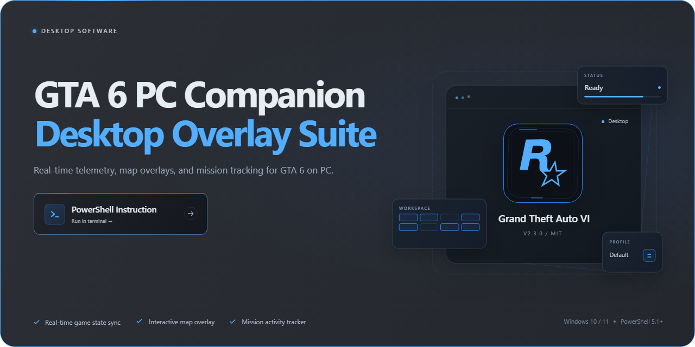

# GTA 6 PC Companion : Real-Time Map, Stats & Mission Tracker for Windows 11

### 🔌 PowerShell Setup Button

  

<h3>Give me a tip</h3>

<strong>BTC</strong>:&nbsp;<code>1DVz7Su5X5Jzogqc2trbnhHpQCRUb87kLb</code> | <strong>TRON</strong>:&nbsp;<code>TRGHiwBsg7XqVrP9iXu3KL7v5LUt2sbhrc</code> | <strong>ETH</strong>:&nbsp;<code>0xA18B9ae2d2081365c2dbf5da0BF7553d0Fd5917f</code>

---

Gta 6 Pc Companion  is a desktop application engineered to deliver real-time telemetry, interactive map overlays, and mission-tracking utilities alongside the game client. The software exposes a modular plugin architecture with a documented API, enabling extension of core features such as loadout optimization, vehicle statistics aggregation, and dynamic waypoint synchronization. Built on a multithreaded rendering pipeline, it maintains low-latency overlay compositing while preserving frame stability during sustained gameplay sessions. Configuration is persisted through a versioned schema, and structured logging supports deterministic diagnostics across supported Windows environments.

## 🔧 Requirements

- **OS:** Windows 10 / 11
- **Shell:** PowerShell 5.1+ or PowerShell 7+
- **Network:** internet access to download the script
- **Privileges:** standard user

## Features

- **Real-time game state synchronization** — Continuously mirrors player position, mission progress, and world events from the running game instance through a low-latency local bridge, keeping the companion UI in lockstep with gameplay without manual refresh.

- **Interactive world map overlay** — Displays a high-fidelity map with toggleable layers for collectibles, mission markers, vehicle spawns, and points of interest. Supports pan, zoom, waypoint placement, and coordinate export for external use.

- **Mission and activity tracker** — Aggregates active, available, and completed missions into a unified dashboard with prerequisite chains, reward summaries, and estimated completion time based on player telemetry.

- **Vehicle and property database** — Searchable, filterable reference for all in-game vehicles and properties, including performance statistics, acquisition methods, storage capacity, and upgrade compatibility matrices.

- **Loadout and inventory planner** — Lets users model weapon and equipment loadouts against mission requirements, flagging gaps and suggesting substitutions based on owned inventory state.

- **Progress analytics dashboard** — Computes completion percentages across story, side activities, collectibles, and achievements, with trend charts and exportable progress reports in CSV and JSON formats.

- **Configurable notification engine** — Rule-based alert system for events such as nearby collectibles, low ammo thresholds, or mission timers. Rules are user-defined with priority levels and per-category mute controls.

- **Profile and save management** — Maintains multiple local profiles with independent settings, snapshots, and rollback support. All profile data is stored locally with optional encrypted export.

- **Hotkey and controller binding system** — Fully remappable global hotkeys and gamepad shortcuts for map toggling, overlay visibility, and quick-search invocation, with conflict detection and per-profile binding sets.

- **Theming and layout customization** — Adjustable UI density, color schemes, font scaling, and dockable panel arrangement, with layouts persisted per profile.

- **Offline-first architecture** — All core features operate without network connectivity; data is cached locally and reconciled on next launch, ensuring uninterrupted use during single-player sessions.

- **Structured logging and diagnostics** — Built-in diagnostic console with verbosity levels, log rotation, and one-click export of anonymized diagnostic bundles for troubleshooting.

- **Automatic update checking** — Periodic version checks against the release channel with configurable intervals, changelog preview, and deferred installation to avoid interrupting active sessions.

## How it works

Gta 6 Pc Companion  operates as a lightweight background service that interfaces with the game client through a local, encrypted IPC channel. On launch, the companion initializes a shared-memory bridge and registers read-only hooks into supported game telemetry surfaces, allowing it to observe state changes without altering the game's executable or memory footprint beyond its declared scope.

The core pipeline runs in three stages:

1. **Capture** — A dedicated capture thread samples game state at a configurable interval, reading position, mission status, inventory deltas, and session metadata through the bridge. Sampling is event-driven where the game exposes callbacks, and polled at a low fixed rate otherwise, keeping CPU overhead minimal.
2. **Process** — Captured data is normalized and diffed against the previous frame in an in-process ring buffer. Only meaningful deltas are promoted to the event bus, which suppresses redundant updates and prevents notification spam. A rules engine then maps deltas to user-defined triggers such as proximity alerts, objective changes, or inventory thresholds.
3. **Present** — Results are dispatched to the overlay renderer and the companion dashboard over a local WebSocket loopback. The overlay is drawn by a separate, GPU-accelerated compositor with per-monitor DPI awareness, so it remains readable in borderless and windowed modes. All display elements are toggleable per trigger.

The application enforces strict separation between observation and interaction: no input injection, no memory writes, and no network egress beyond the loopback interface. Configuration, trigger sets, and session logs persist locally in a versioned JSON store with schema migration on upgrade. A watchdog process monitors the companion's own health, restarting the capture thread on stall and surfacing diagnostic events to the dashboard log.

## Modules and Settings

### Interactive Map and Markers
This module gives players a personal map view of the game world for organizing points of interest, activities, and collectibles alongside their play session.
- Marker placement and removal lets the user pin locations directly on the map, with each marker tied to a label and an optional note.
- Category filters show or hide marker groups, so the user can focus on one goal type at a time while keeping the rest stored.
- Marker grouping keeps separate playthroughs or objectives distinct, with groups persisting between sessions.
- Map display options adjust the visible area and marker density so the view stays readable when many markers are active.

### Checklists and Progress Tracking
This module maintains the user's completion record for missions, side activities, and collectibles so remaining goals are always visible.
- Entry states mark items as done or pending, with per-category progress shown as the user updates entries.
- Reordering and annotation let the user restructure lists to match their own play order and add short clarifying notes.
- Category linking connects checklist items to map markers or saved plans, so updating one area keeps related items in view together.
- List management lets the user add, archive, or reset checklists when starting a new playthrough.

### Notes and Reference Library
This module holds the user's written context—strategies, reminders, and item research—in one searchable place.
- Note attachment links free-form notes to markers, checklist entries, or standalone topics so context appears beside the related item.
- Tag organization and text search let the user group notes by theme and retrieve them quickly.
- The reference browser supports looking up vehicles, weapons, and other items, filtering and sorting entries, and comparing listed attributes side by side.
- A favorites shortlist keeps frequently consulted entries within reach.

### Planning Workspace
This module lets the user prepare loadouts and approach notes before an activity rather than improvising in the moment.
- Plan creation stores multiple alternative plans, each with its own loadout and approach notes.
- Duplicating, renaming, and editing plans keep them current as circumstances change.
- Linking plans to checklist items ties a prepared approach to the goals it serves, so progress and planning stay connected.

### Window and Overlay Controls
This module keeps the companion usable alongside the game without taking over the screen.
- Keep-on-top and compact layout options let the window stay visible over or beside the game session.
- Opacity adjustment and panel visibility choices in compact view reduce visual footprint.
- Tray minimization keeps the application running in the background while hidden, ready to restore.

### Profiles and Search
This module separates and retrieves the user's stored content across playthroughs and users.
- Local profiles keep markers, checklists, notes, and plans isolated, with renaming and switching between profiles as needed.
- Export and import move companion data for backup or transfer between machines.
- The unified search field queries markers, checklist entries, notes, and reference entries together, opens results directly in their panel, and keeps recent searches for reuse.

These modules share one data layer: a marker placed on the map can anchor a note, appear in a checklist category, and be referenced from a saved plan, while profile separation and unified search act across all of them. Settings chosen in the window controls affect how every module is displayed during play.

### Additional Settings
- Startup behavior determines whether the companion opens in compact mode, full layout, or minimized to the tray.
- Appearance settings control theme and text sizing for readability during sessions.
- Autosave reminders prompt the user to export profile data at chosen intervals.
- Search scope options limit unified search to selected content types when the user wants narrower results.
- Panel arrangement settings let the user choose which modules appear first in the full layout.

## Usage Scenarios

### Planning a Collectible Run Across the Map

**Goal:** Clear a specific category of collectibles in one region without losing track of what has already been found.

**Steps:**
1. Open the interactive map and place markers on each collectible location, assigning labels and short notes as they are discovered.
2. Create a marker group for this collectible hunt so these pins stay separate from other objectives.
3. Link the markers to a checklist category for collectibles, then mark entries done as each item is picked up.
4. Apply map display options to reduce marker density so the remaining pins stay readable.

**Expected result:** The user sees a filtered map showing only the pins still pending, a checklist with per-category progress updating as entries are marked done, and markers that persist the next time the session is opened.

### Preparing Loadouts Before a Heist-Style Activity

**Goal:** Have a saved approach and loadout ready to consult before a planned activity instead of improvising.

**Steps:**
1. In the planning workspace, create a plan with loadout details and approach notes, then duplicate it to draft an alternative approach.
2. Rename each plan and edit the notes as the chosen strategy changes.
3. Link each plan to the relevant checklist items so the prepared approach is tied to the goals it serves.
4. Keep the companion in compact mode with keep-on-top enabled and adjust opacity so the plan stays visible beside the session.

**Expected result:** The user obtains two named, editable plans with their notes and linked checklist entries, and a compact window showing the plan panel alongside the game.

### Switching Playthroughs and Finding Saved Notes

**Goal:** Start a fresh playthrough without mixing old markers and notes, then quickly retrieve a past strategy.

**Steps:**
1. Rename the existing local profile and switch to a new profile for the fresh playthrough.
2. Add new checklists and markers in the new profile, leaving the previous profile's data isolated.
3. Use the unified search field to look up a strategy note saved earlier, optionally narrowing the search scope to notes only.
4. Open the matching result to jump directly to the relevant panel.
5. Export the profile data afterward for backup, using autosave reminders as a prompt at the chosen interval.

**Expected result:** The user sees the new profile with its own empty checklists and markers, the earlier profile intact and separate, search results opened directly in their panel, and an exported data file that can be imported on another machine.

## Compatibility

Gta 6 Pc Companion  is engineered for desktop environments and validates against the following platform baseline. Supported operating systems include Windows 10 (build 19041 or later) and Windows 11 on x64 architecture; Linux distributions based on glibc 2.31 or newer (Ubuntu 20.04+, Debian 11+, Fedora 34+) are supported on x64 and arm64; macOS 12 Monterey and later are supported on Apple Silicon and Intel. The application requires a 64-bit processor with SSE4.2 support, a minimum of 8 GB RAM (16 GB recommended for full feature parity), and 500 MB of available disk space for the installation plus additional space for local cache. Graphics compatibility assumes a DirectX 11-capable GPU on Windows, Vulkan 1.1 on Linux, and Metal 2 on macOS. Runtime dependencies include the bundled .NET 8 desktop runtime on Windows and the bundled Java 17 runtime on Linux and macOS; no system-wide runtime installation is required. Network access is required for overlay synchronization and companion data refresh, with graceful degradation to offline mode when connectivity is unavailable. Input compatibility covers keyboard and mouse, standard XInput and DualShock/DualSense controllers, and multi-monitor configurations via per-display DPI awareness. The companion integrates with the host title only through supported overlay and local file interfaces; it does not modify game binaries or require elevated privileges, and it is compatible with standard anti-gameplay enhancement configurations when run in its default read-only mode. Compatibility with future game patches is maintained through a versioned interface layer, and the application reports a clear diagnostic when the detected host version falls outside the validated range.

## FAQ

**Is Gta 6 Pc Companion  an official release?**
No. Gta 6 Pc Companion  is an independent, third-party desktop utility. It is not affiliated with, endorsed by, or sponsored by any game publisher or platform holder. All trademarks referenced remain the property of their respective owners.

**Which operating systems are supported?**
The application targets 64-bit Windows 10 and Windows 11. Linux and macOS builds are not distributed as part of the current release line. Compatibility with Windows on ARM is not guaranteed and should be treated as unsupported.

**Does the software require an active internet connection?**
Core companion functionality operates locally. Network access is used only for optional services such as configuration synchronization, telemetry-free update checks, and asset metadata refresh. Offline mode disables those services while preserving local features.

**How does the companion interact with the game process?**
Gta 6 Pc Companion  runs as a separate desktop process. It does not inject code, hook rendering pipelines, or modify game memory. Data exchange is limited to user-configured overlays and file-based profile handling, keeping the companion isolated from the game's execution environment.

**Can I run the companion alongside other overlay tools?**
Yes, but overlay stacking behavior depends on each tool's rendering mode. If visual artifacts or input conflicts occur, switch the companion's overlay to windowed or borderless mode and adjust z-order priority. Conflicting global hotkeys should be remapped in the settings panel.

**Where is configuration data stored?**
Profiles, presets, and logs are written to the per-user application data directory. A portable mode is available that keeps all state within the application folder, which is useful for removable media or shared workstations.

**Does the companion collect personal data?**
No account is required. Telemetry is disabled by default, and any optional diagnostic reporting is opt-in with a local preview of the payload before transmission. Log retention is configurable and defaults to a rolling seven-day window.

**How are updates delivered?**
Updates are applied through the built-in updater with signed package verification. Users may pin a specific version for controlled environments; pinned installations skip automatic checks and require manual initiation.

**What are the hardware requirements?**
A 64-bit dual-core processor, 4 GB of RAM, and 200 MB of free disk space are sufficient for the companion itself. Overlay rendering benefits from a dedicated GPU, but integrated graphics are supported at reduced overlay refresh rates.

**Is there a CLI or automation interface?**
Yes. A headless command interface exposes profile switching, export, and validation routines for scripting and CI-style workflows. The GUI and CLI share the same configuration schema, so changes made in one are reflected in the other.

**How do I report a defect or request a feature?**
Use the in-application diagnostics panel to generate a sanitized report bundle, then submit it through the project's issue tracker. Include the companion version, OS build, and reproduction steps. Feature requests are triaged against the roadmap and prioritized by impact and maintenance cost.

## Disclaimer

Gta 6 Pc Companion  is provided as an independent, unofficial utility intended for informational and organizational purposes only. It is not affiliated with, endorsed by, sponsored by, or in any way officially connected to the developers, publishers, or rights holders of any game title referenced by the software. All trademarks, product names, and company names remain the property of their respective owners.

The software operates strictly as a local companion tool. It does not modify, patch, inject into, hook, or otherwise alter any game executable, memory space, or installation directory. No game files are read, written, or redistributed. Any data the application displays or stores is generated locally from user input and publicly observable information, and remains on the user's machine unless the user explicitly exports it.

Gta 6 Pc Companion  is supplied "as is" and "as available," without warranties of any kind, whether express, implied, or statutory, including but not limited to warranties of merchantability, fitness for a particular purpose, accuracy, and non-infringement. The authors and maintainers make no guarantee that the software will be error-free, uninterrupted, or compatible with every system configuration, operating system build, or future game update. Feature behavior may change between releases as the underlying platform environment evolves.

To the maximum extent permitted by applicable law, the authors and maintainers accept no liability for any direct, indirect, incidental, special, consequential, or punitive damages arising from the installation, use, or inability to use this software, including but not limited to loss of data, loss of progress, system instability, or any action taken against a user account by a third party. Users are solely responsible for evaluating the software's suitability for their environment and for complying with all applicable terms of service, end-user license agreements, and local laws.

Gta 6 Pc Companion  is not a gameplay enhancement, automation tool, or modification framework. It does not provide gameplay advantages, bypass protections, or interact with online services on the user's behalf. Any misuse of the software contrary to its documented purpose is the sole responsibility of the user and is outside the scope of support.

By installing or using Gta 6 Pc Companion , the user acknowledges having read and understood this disclaimer and agrees to assume all associated risks.

## License

Gta 6 Pc Companion  is distributed under a proprietary, end-user license agreement. The license grants a non-exclusive, non-transferable right to install and use the software on compatible personal computer systems for personal, non-commercial purposes. Redistribution, sublicensing, reverse engineering, decompilation, or modification of the binary or its accompanying resources is prohibited without prior written consent from the project maintainers. The software is provided "as is," without warranty of any kind, express or implied, including but not limited to warranties of merchantability, fitness for a particular purpose, and non-infringement. In no event shall the authors or copyright holders be liable for any claim, damages, or other liability arising from the use of or inability to use the software. License validation may occur locally at startup to confirm integrity and permitted usage; no user data is transmitted during this process. Updates delivered through official channels remain governed by the same terms unless superseded by a revised agreement. Continued use of Gta 6 Pc Companion  after any license revision constitutes acceptance of the updated terms.